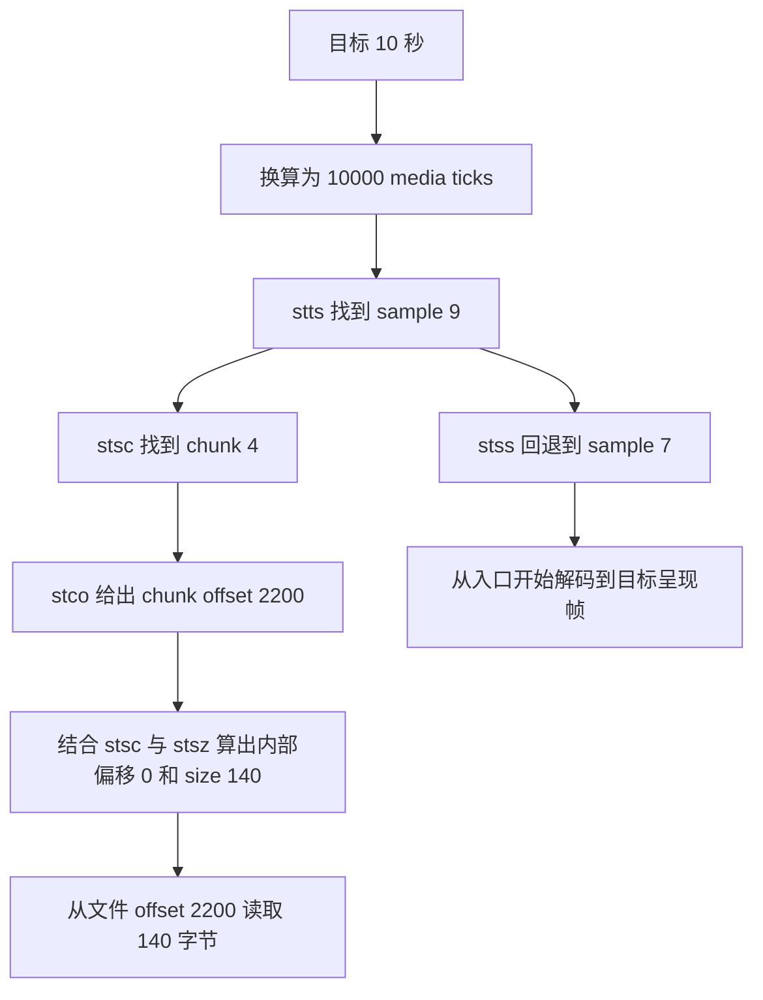

# 7-8 MP4 格式分析

> 项目章节 08 · Markdown 讲义 · 2026-10-13
>
> 本讲从文件字节、Box 层级和媒体轨道讲起，逐步建立时间与空间索引，最后完成 sample 定位和随机访问的推导。正文包含所需的定义、结构图、完整教学数据和练习答案，可以独立学习。

## 01 学习目标与阅读路线

播放器收到一个 MP4 文件后，需要依次回答：里面有哪些音视频流？数据采用什么编码？每个编码单元何时解码、何时显示？它位于文件的哪里？从哪里开始解码才能跳转到目标时刻？

MP4 把这些问题分成两部分：**`moov` 保存描述和索引，`mdat` 保存编码后的媒体字节。** 读取 MP4 的核心，就是利用描述和索引找到媒体字节，再按 codec 的规则解码。

学完本讲，应能完成以下任务：

1. 读懂 `moov → trak → mdia → minf → stbl` 的层级和各 Box 的职责。
2. 区分 track、sample、chunk、NALU 和 PCM 采样点。
3. 根据 `stts / ctts / elst` 换算 DTS、PTS 与播放器时间。
4. 根据 `stsc / stsz / stco` 算出 sample 的文件偏移和字节长度。
5. 根据 `stss` 选择解码入口，并解释为什么 seek 需要继续解码到目标帧。

| 学习阶段 | 章节 | 要解决的问题 |
|---|---|---|
| 文件结构 | 02-04 | Box 怎么读？索引与媒体字节如何组织？ |
| 轨道与媒体描述 | 05-08 | 多轨如何区分？codec 配置在哪里？ |
| 时间索引 | 09-11 | DTS、PTS、edit list 和 seek 如何关联？ |
| 空间索引 | 12-13 | sample 属于哪个 chunk？其绝对偏移是多少？ |
| 完整推导 | 14-15 | 用一套完整输入算出时间、sample、chunk、offset、size |
| 实战与扩展 | 16-18 | 如何观察真实文件？普通 MP4 与 fMP4 有何区别？ |
| 自测 | 19 | 是否已经能够独立解释和复算？ |

正文以普通、自包含、未加密的 MP4 为基础。外部数据引用、fMP4 和复杂随机访问在扩展部分说明。所有手算例都是明确设定的教学数据，目的是验证索引关系，不要求准备某个指定媒体文件。

## 02 MP4 是容器，H.264 和 AAC 是编码格式

MP4 属于 MPEG-4 Part 14，基于 ISO Base Media File Format（ISO BMFF）。H.264 / AVC 描述视频如何压缩，AAC 描述音频如何压缩；MP4 描述如何把编码数据与轨道、时间、索引、元数据组织成文件。

同一种编码格式可以用于不同容器，例如 H.264 数据可以存储在 MP4、FLV 等容器中。一个 MP4 可以包含多条音轨、视频轨和字幕轨；仅凭文件扩展名，无法判断每条轨道使用的 codec。本文所说的 codec 信息包括编码类型和解码所需的参数。

| 操作 / 数据 | 含义 | 常见输入与输出 |
|---|---|---|
| 编码 | 将原始媒体数据压缩为编码数据 | PCM → AAC；YUV 图像 → H.264 |
| 封装 | 将编码数据与时间、轨道信息组织到容器中 | H.264 + AAC → MP4 |
| 解封装 | 读取容器，取出编码数据及其描述、时间信息 | MP4 → 编码 packet |
| 解码 | 根据 codec 配置和编码数据还原媒体内容 | AAC → PCM；H.264 → 图像帧 |

PCM 是未压缩音频的采样表示，YUV 是常见的图像像素表示。读取 `mdat` 中一段 H.264 字节，得到的是压缩数据，通常还需要解码器及前置参考帧，才能得到可显示的图像。

## 03 Box 基础：先读边界，再解释 payload

### 3.1 常规 Box 头

MP4 的基本结构单元是 Box。常规 Box 的头部有 8 字节，整数通常采用 big-endian，即高位字节在前。

```text
字节偏移     长度       内容
0            4         size：整个 Box 的字节数
4            4         type：通常是四字符代码 FourCC
8            可变      payload：字段、子 Box 或媒体字节
```

例如 `00 00 00 20 66 74 79 70` 表示：`size=0x20=32`，`type='ftyp'`。这 32 字节包括已经读取的 8 字节头，payload 因此为 24 字节。下一个兄弟 Box 通常位于 `当前 Box 起点 + 32`。

### 3.2 特殊 size 和扩展头

| 情况 | 含义 | 头部处理 |
|---|---|---|
| 常规 size | 给出总长度，包括头部 | 基础头为 8 字节 |
| `size == 1` | 实际总长度由 `largesize` 给出 | type 后读取 8 字节 largesize，基础头变为 16 字节 |
| `size == 0` | 延伸到文件末尾 | 不能当作空 Box；需检查所在层级和边界约束 |
| `type == uuid` | 使用扩展类型标识 | 另有 16 字节 usertype，不能直接从偏移 8 读 payload |

### 3.3 FullBox

部分 Box 在基础头后增加 `version`（1 字节）和 `flags`（3 字节），这种形式称为 FullBox。常规尺寸的 FullBox 专用字段因此从偏移 12 开始。`stts / stsc / stsz / stco / stss` 等都采用这类结构。

```text
size(4) | type(4) | version(1) | flags(3) | 专用字段...
```

version 会改变字段长度或解释方式。比如 `ctts` version 0 的 offset 为无符号，version 1 为有符号；时间类 Box 的 version 1 常使用更宽的时间字段。

### 3.4 容器 Box 和媒体数据 Box

`moov / trak / mdia / minf / stbl` 是常见容器 Box，内部按规定包含子 Box。`mdat` 的 payload 是媒体字节，不能把它的全部内容当作子 Box 递归解析。`stsd` 的 sample entry 也有自己的固定字段布局，子 Box 并不一定紧跟 8 字节头。

读取 Box 时应先确定起点、总长度、头长和父级边界，再解释内容。未知类型可以按合法 size 跳过。不能仅搜索字节串 `moov` 来定位 Box，因为媒体数据中也可能碰巧包含这几个字节。[Apple 的 Box / Atom 结构说明](https://developer.apple.com/documentation/quicktime-file-format/atoms)可用于进一步核对。

## 04 顶层结构：ftyp、moov、mdat 与 faststart

| Box | 职责 | 主要信息 |
|---|---|---|
| `ftyp` | 声明文件格式兼容性 | major_brand、minor_version、compatible_brands |
| `moov` | 描述整个 movie 和各条轨道 | 轨道属性、时间刻度、解码配置、sample 索引 |
| `mdat` | 保存实际媒体字节 | 可交织多条轨道的数据，也可出现多个 mdat |
| `free / skip` | 预留或填充空间 | 不应计入某个 sample 的编码数据长度 |
| `udta / meta` | 附加元数据 | 可位于规定的不同层级；不能一律视为顶层 Box |

### 4.1 ftyp 的完整小例

设一个 `ftyp` 总长 32 字节，内容如下：

| 文件内相对偏移 | 长度 | 值 | 解释 |
|---|---|---|---|
| 0 | 4 | 32 | Box 总长度 |
| 4 | 4 | ftyp | Box 类型 |
| 8 | 4 | isom | major_brand |
| 12 | 4 | 512 | minor_version，按品牌定义解释 |
| 16 | 4 | isom | 第 1 个 compatible_brand |
| 20 | 4 | iso2 | 第 2 个 compatible_brand |
| 24 | 4 | avc1 | 第 3 个 compatible_brand |
| 28 | 4 | mp41 | 第 4 个 compatible_brand |

总长度正好是 `8 + 4 + 4 + 4×4 = 32`。兼容品牌帮助判断文件的格式约束，实际视频、音频 codec 仍应读取各轨道的 `stsd`，不能只看品牌。

### 4.2 moov 位置与播放

普通 MP4 可以组织为：

```text
布局 A：ftyp | mdat | moov
布局 B：ftyp | moov | mdat
```

布局 A 中，下载器可能需要读取文件末尾才能取得完整索引；布局 B 中，较早取得 `moov` 有助于渐进下载播放。实际体验还取决于音视频交织和网络访问方式。

`faststart` 通常将普通 MP4 的 `moov` 移到文件前部。媒体字节的文件位置随之改变，`stco / co64` 等绝对偏移也必须更新；不能直接剪切粘贴几个 Box。若偏移升级为 `co64`，索引 Box 的大小还会变化。

`moov` 前置和 fMP4 是不同的组织方式：前者仍可使用集中 sample 表，后者使用分片相关 Box 描述样本。使用 FFmpeg 的 `-movflags +faststart` 可以完成适用文件的重排。

## 05 moov、trak、mdia：三层描述各管什么

### 5.1 结构树

本讲的 movie 表示整个文件的播放组织及公共时间轴；每条 track 的 media 表示该轨道的媒体数据及其时间轴。movie 与各轨道的 media 可以使用不同的 timescale。

下面展示两条音轨和一条视频轨的逻辑结构。可选项用 `optional` 标记；各轨拥有自己的时间和 sample 表。

```text
MP4 file
├── ftyp
├── moov
│   ├── mvhd                         movie 级描述
│   ├── trak                         音频 A
│   │   ├── tkhd
│   │   ├── edts / elst              optional
│   │   └── mdia
│   │       ├── mdhd
│   │       ├── hdlr                 soun
│   │       └── minf
│   │           ├── smhd
│   │           ├── dinf / dref
│   │           └── stbl             该音轨自己的 sample 表
│   ├── trak                         音频 B，具有同样的独立层级
│   ├── trak                         视频
│   │   ├── tkhd
│   │   ├── edts / elst              optional
│   │   └── mdia
│   │       ├── mdhd
│   │       ├── hdlr                 vide
│   │       └── minf
│   │           ├── vmhd
│   │           ├── dinf / dref
│   │           └── stbl
│   │               ├── stsd         codec 描述
│   │               ├── stts         解码时间增量
│   │               ├── ctts         optional：呈现时间偏移
│   │               ├── stss         optional：同步 sample
│   │               ├── stsc         sample 到 chunk
│   │               ├── stsz / stz2  sample 长度
│   │               └── stco / co64  chunk 文件位置
│   └── udta / meta                  optional
└── mdat                             媒体字节，内部不是上述 trak 树
```

`trak` 是 Box 的四字符名称，track 是轨道这个概念。`mdat` 内可以出现如下物理交织：

```text
[音频 A chunk 1][视频 chunk 1][音频 B chunk 1]
[音频 A chunk 2][视频 chunk 2][音频 B chunk 2]...
```

逻辑上每条 track 有自己的 sample 序列；物理上不同轨道的 chunk 可以交替放置。

### 5.2 mvhd：整个 movie 的描述

| 字段 | 含义 | 如何阅读 |
|---|---|---|
| creation_time / modification_time | 创建和修改时间 | 标准时间字段采用从 1904-01-01 起算的秒数；实际文件可能未填写有效值 |
| timescale | movie 每秒的 tick 数 | duration 的单位由它决定 |
| duration | movie 时长 | duration / timescale 得到秒 |
| rate | 常见的播放速率字段 | 16.16 定点数；65536 表示 1.0 |
| volume | 常见音量字段 | 8.8 定点数；256 表示 1.0 |
| matrix | 变换矩阵 | 与坐标、显示变换有关；不能把所有元素按同一种定点格式解释 |
| next_track_ID | 后续可分配的轨道标识 | 不能用它直接推出当前轨道数量 |

常见 16.16 数值的换算是 `存储值 / 65536`，8.8 数值的换算是 `存储值 / 256`。例如宽度字段存储 `1920×65536`，显示宽度才是 1920，而不是那个较大的整数。

### 5.3 tkhd：一条 track 在 movie 中的属性

`tkhd` 记录 track_id、启用标记、轨道时长、图层、alternate_group、音量、变换矩阵、显示宽高等。这里的 duration 使用 **movie timescale**，不是该 track 的 media timescale。

`alternate_group` 可以表示可相互替换的轨道，例如不同语言的音轨。音频轨的宽高通常为 0；视频轨的显示尺寸还可能受到矩阵、裁剪、像素宽高比影响。`tkhd` 的显示宽高与视频 sample entry 的编码宽高不是同一个概念。

### 5.4 mdhd、hdlr、minf 和 dinf

| Box | 内容 | 重点 |
|---|---|---|
| `mdhd` | media timescale、media duration、语言等 | 本 track 的媒体时间单位 |
| `hdlr` | handler_type 和可读名称等 | vide 表示视频，soun 表示音频 |
| `minf` | 媒体专用信息与索引的容器 | 常包含媒体头、dinf 和 stbl |
| `vmhd` | 视频媒体头 | 常见 graphicsmode、opcolor 等字段 |
| `smhd` | 音频媒体头 | 常见 balance 等字段 |
| `dinf / dref` | 数据来源引用 | 自包含文件与外部数据引用的区别在这里体现 |

`mdhd.language` 表示语言代码；`hdlr` 等位置的可读音轨名称是另一种信息。名称写“音频 A”，语言字段仍可以是 `und`，表示未确定语言。

时间类 Box 要先读 version。例如 `mvhd / mdhd` version 0 常使用 32-bit 创建时间、修改时间和 duration；version 1 将这些字段扩展为 64-bit，timescale 仍为 32-bit。不能沿用同一套固定字节偏移解释两个版本。

## 06 多轨时间刻度与标识体系

### 6.1 一个三轨元数据示例

设 movie timescale=1000、duration=5016；两条音轨采用 AAC、双声道、44100 Hz；视频采用 H.264，编码尺寸 1920×800。下表直接给出需要阅读的字段。

| 字段 | 音频 A | 音频 B | 视频 |
|---|---|---|---|
| track_id | 1 | 2 | 3 |
| hdlr.handler_type | soun | soun | vide |
| media timescale | 44100 | 44100 | 90000 |
| mdhd.duration | 221184 | 221184 | 438750 |
| 媒体时长（秒） | 约 5.015510 | 约 5.015510 | 4.875 |
| tkhd.duration（movie tick） | 5016 | 5016 | 4875 |
| stsd sample entry | mp4a | mp4a | avc1 |
| 主要解码配置 | esds / AudioSpecificConfig | esds / AudioSpecificConfig | avcC / SPS / PPS |
| 显示 / 音频属性 | 2 声道、44100 Hz | 2 声道、44100 Hz | 1920×800 |
| 典型媒体头 | smhd | smhd | vmhd |

换算方法都是 `duration / timescale`：

```text
movie：5016 / 1000 = 5.016 s
视频：438750 / 90000 = 4.875 s
音频：221184 / 44100 ≈ 5.015510 s
```

这些字段用于练习元数据阅读，不用它们推算后文完整主例的字节位置。不同轨道的结束时刻可能不同；采样粒度、edit list、编码延迟和尾部安排都可能影响它们，仅凭 duration 的差值不能判断音画是否同步。

### 6.2 timescale、time_base 与帧率

timescale 表示每秒有多少个 tick。FFmpeg 的 `time_base` 表示一个时间戳单位是多少秒；在简单映射中，media timescale=90000 对应 `time_base=1/90000`。

| 数值 | 换算 |
|---|---|
| 视频时间戳 90000，time_base=1/90000 | 1 秒 |
| 音频时间戳 44100，time_base=1/44100 | 1 秒 |
| 视频 sample_delta=3720、timescale=90000 | 约 41.333 毫秒 |
| 音频 sample_delta=1024、timescale=44100 | 约 23.220 毫秒 |

时间戳整数不同，可以代表同一时刻；整数相同，也可能代表不同的时刻。比较前必须统一单位和时间轴起点。timescale=90000 本身不表示帧率为 90000，也不表示每个 sample 都长 90000 ticks。

### 6.3 三种标识不能混用

| 标识 | 它标记什么 | 取值示例 |
|---|---|---|
| track_id | 文件中的轨道 | 视频 track_id=3 |
| AVStream.index | FFmpeg 当前上下文中的 stream 数组下标 | 同一视频流可能 index=2 |
| sample_description_index | stsd 中采用哪个描述项 | 1 表示第 1 个 sample description |

三个值可能碰巧相同，但含义不同。视频 track_id=3 不意味着可以读取 `streams[3]`，描述项索引 1 也不意味着选择音频 track 1。

## 07 sample、chunk、NALU 与 PCM 采样点

| 概念 | 所属层次 | 含义 |
|---|---|---|
| track | 容器逻辑层 | 一条媒体轨道及其描述 |
| sample | 容器媒体层 | 轨道中的一个基本媒体数据单元；在本讲的压缩音视频场景中，通常对应一个编码单元 |
| chunk | 文件存储组织层 | 同一 track 中连续的一组 sample |
| NALU | 视频编码层 | H.264 等编码格式的码流单元 |
| PCM 采样点 | 原始音频层 | 某一声道在某个采样时刻的数值 |

H.264 视频的一个 MP4 sample 通常对应一个 access unit，即编码层用于组织一次图像解码的数据单元。它可以包含一个或多个 slice NALU，也可能包含 AUD、SEI 等辅助 NALU：slice 承载图像编码数据，AUD 用于标识 access unit 边界，SEI 提供补充信息。

AAC 的一个编码 sample 通常覆盖每声道多个 PCM 采样点，例如常见配置覆盖 1024 个；因此它不能直接理解成单个 PCM 数值。

在双声道音频中，每声道 1024 个 PCM 采样点意味着有两组声道采样数据；时长仍为 `1024 / sample_rate`，不应再乘以声道数。

一个 chunk 内的 sample 按顺序连续存放；两个 chunk 之间可以有另一条 track 的字节。因此目标 sample 的 chunk 内偏移，只累加**同一 chunk 内位于它之前的 sample size**。

### 7.1 多 sample / chunk 的完整分配例

设视频共有 117 个 sample，每个 chunk 放 1 个，因此有 117 个 chunk。另一条音轨共有 214 个 chunk，按下面的 `stsc` 规则存放：

| first_chunk | samples_per_chunk | sample_description_index |
|---|---|---|
| 1 | 1 | 1 |
| 85 | 2 | 1 |
| 86 | 1 | 1 |
| 89 | 2 | 1 |
| 90 | 1 | 1 |

展开后，chunk 1-84 各放 1 个，chunk 85 放 2 个，chunk 86-88 各放 1 个，chunk 89 放 2 个，chunk 90-214 各放 1 个。总 sample 数为：

```text
84×1 + 1×2 + 3×1 + 1×2 + 125×1 = 216
```

最后一条规则一直延续到实际 chunk 总数 214，并非只作用于 chunk 90。音轨和视频轨都必须查自己的表。

本讲 sample_number、chunk_number 和 sample description 的序号从 1 开始；代码数组通常从 0 开始，需要明确转换。

## 08 stsd：sample 的解释方式与解码配置

### 8.1 stsd 的基本组织

`stsd` 是 Sample Description Box。它在 FullBox 字段后包含 `entry_count` 和相应数量的 sample entry。每个 entry 有类型、数据引用和媒体专用字段，内部还可能有 codec 配置 Box。

```text
视频：stsd → avc1 → avcC
                  └→ pasp（optional）
音频：stsd → mp4a → esds → DecoderSpecificInfo
                              └→ AudioSpecificConfig
```

sample entry 中的 `data_reference_index` 指向 `dref` 的数据引用项；`stsc.sample_description_index` 则指向 `stsd` 的描述项。这又是两个不同索引。

### 8.2 H.264 的 avc1、avcC 与 pasp

| 位置 | 内容 | 用途 |
|---|---|---|
| avc1 sample entry | 编码宽高等视频属性 | 解释该轨道的视频格式 |
| avcC | AVCDecoderConfigurationRecord | 提供 profile、level、NAL 长度字段宽度、SPS / PPS 等 |
| SPS | Sequence Parameter Set | 描述尺寸、profile、参考帧及其他序列参数 |
| PPS | Picture Parameter Set | 描述与图像 / slice 解码有关的参数 |
| SPS 的 VUI | 可选的显示与时序信息 | 可包含色彩、宽高比、timing 等；不能替代容器时间表 |
| pasp | hSpacing、vSpacing | 像素宽高比，不是图像像素宽 / 高 |

一个配置读取例：AVCProfileIndication=100、AVCLevelIndication=40、lengthSizeMinusOne=3、SPS 数=1、PPS 数=1。它表示 High profile、level 4.0，sample 中的 NAL 长度字段宽度为 `3+1=4` 字节。profile 和 level 描述编码约束，不能据此计算 MP4 sample 的 DTS。

这里的 lengthSizeMinusOne 合法值为 0、1、3，分别表示 1、2、4 字节长度字段；值 2 是保留值，不能仅按“加 1”推成合法的 3 字节字段。读取 SPS / PPS 数组时，每项还有自身的长度和数据，部分 profile 还包含扩展配置，应按结构逐项解释。

若 `pasp.hSpacing=vSpacing=1`，像素宽高比为 1:1。若存在旋转或非方形像素，编码尺寸、显示尺寸和显示宽高比需要分别理解。

SPS 也可以描述尺寸。例如 `pic_width_in_mbs_minus1=119`、`pic_height_in_map_units_minus1=49`、`frame_mbs_only_flag=1` 且无裁剪时：

```text
coded_width  = (119 + 1) × 16 = 1920
coded_height = (2 - 1) × (49 + 1) × 16 = 800
```

这里的尺寸推导属于 H.264 编码层。若存在 frame cropping，还要根据 chroma format 等信息换算裁剪单位；不能无条件从上式得到最终显示尺寸。

### 8.3 长度前缀与 Annex B

MP4 中的 AVC sample 常以长度前缀组织 NALU；长度字段宽度由 `avcC` 决定。长度值描述接下来的 NALU 字节数，不包含长度字段自身。

一个完整字节长度例：长度字段为 4 字节，sample 含两个 NALU。

```text
00 00 00 02 | NALU A：2 字节
00 00 51 BC | NALU B：20924 字节
```

`0x51BC=20924`，所以 sample size 为 `4+2+4+20924=20934` 字节。仅把两个 NALU 的长度相加，会漏掉 8 字节前缀。

Annex B 使用 `00 00 01` 或 `00 00 00 01` start code。MP4 sample 中的长度前缀不是 start code；输出裸 H.264 时通常需要码流转换，并根据配置提供 SPS / PPS。FFmpeg 提供 `h264_mp4toannexb` bitstream filter。

### 8.4 AAC 的 mp4a 和 AudioSpecificConfig

`mp4a` sample entry 描述音频属性，`esds` 描述符中可包含 AudioSpecificConfig。后者提供 audioObjectType、采样率索引 / 采样率和声道配置等信息。例如 AAC-LC、44100 Hz、双声道是一组常见配置。

sample entry 的字段后接的是有独立结构的子 Box；看到 `esds` 应进入描述符布局，不能继续把这些字节当作固定音频字段。压缩音频 entry 的样本位深字段，也不能直接当成解码后 PCM 必然使用的 sample format。

MP4 中的 AAC packet 通常没有 ADTS 头。解码时使用对应的配置；输出裸 `.aac` 时，应使用适当的 AAC muxer 或正确的 ADTS 包装逻辑。`esds` 不应直接附加到每个 packet 前面。

## 09 stts 与 ctts：解码时间和呈现时间

### 9.1 stts 的 run-length 表

DTS（Decoding Time Stamp）表示 sample 的解码时间戳；PTS（Presentation Time Stamp）表示其呈现时间戳。解码器按解码顺序处理 sample，播放器按呈现时间安排输出，两者在存在重排序时可能不同。

`stts` 是 Time-to-Sample Box，记录按解码顺序排列的 sample 时长。FullBox 字段后先有 32-bit entry_count，每条 entry 再有两个 32-bit 字段：

| 字段 | 含义 | 单位 |
|---|---|---|
| sample_count | 本 entry 连续描述多少个 sample | 数量 |
| sample_delta | 这些 sample 各自的解码时间增量 | 本 track 的 media tick |

连续多个 sample 的 delta 相同，就可以用一条 entry 描述。这一段连续 sample 称为一个 run，因此 entry_count 是 run 的数量，不是 sample 的总数。

```text
sample_total   = Σ(entry.sample_count)
decode_duration = Σ(entry.sample_count × entry.sample_delta)
DTS(1)         = 0
DTS(i)         = Σ(delta(k)), k 从 1 到 i-1
```

DTS 从 0 开始是本讲基础媒体时间轴的设定；播放器或 demuxer 应用 edit list 后，输出时间戳可能有偏移。decode_duration 表示 stts 定义的解码时间累计长度，不应直接当作 mdhd.duration 或最终播放时长。文件声明的媒体时长应单独读取，实际呈现时长还需结合 PTS 和 edit list 判断。

### 9.2 主例的时间表

后文使用同一套主例。media timescale=1000，无 edit list，PTS=DTS；时间表只有两条 entry：

| sample_count | sample_delta |
|---|---|
| 6 | 1000 |
| 4 | 2000 |

entry_count=2，sample 总数为 `6+4=10`，解码时间累计长度为 `6×1000+4×2000=14000` ticks，即 14 秒。本主例没有重排序和 edit list，并明确按表中的 delta 设置呈现时长，所以呈现总时长也是 14 秒。

| sample | DTS（tick） | delta（tick） | 时间区间（秒） |
|---|---|---|---|
| 1 | 0 | 1000 | [0,1) |
| 2 | 1000 | 1000 | [1,2) |
| 3 | 2000 | 1000 | [2,3) |
| 4 | 3000 | 1000 | [3,4) |
| 5 | 4000 | 1000 | [4,5) |
| 6 | 5000 | 1000 | [5,6) |
| 7 | 6000 | 2000 | [6,8) |
| 8 | 8000 | 2000 | [8,10) |
| 9 | 10000 | 2000 | [10,12) |
| 10 | 12000 | 2000 | [12,14) |

区间采用左闭右开：10 秒命中 sample 9；14 秒已到末尾，不属于 sample 10。真实文件可能存在 1023 / 1024 / 1025 或其他变化的 delta，应读取表值，不能硬编码固定时长。

若目标 T 落在某条 run 内，且 delta 为正，则：

```text
run 内 0-based 位置 = floor((T - run_start_DTS) / sample_delta)
sample_number = 此前 sample 总数 + run 内位置 + 1
```

如果 T 已超出该 run 的结束时刻，应继续查下一条；遇到特殊时间增量，按格式语义处理，不能盲目相除。

### 9.3 ctts 把 DTS 映射为媒体 PTS

`ctts` 是 Composition Time-to-Sample Box，也采用 run-length 形式，entry 包含 sample_count 和 sample_offset。

```text
PTS(i) = DTS(i) + composition_offset(i)
```

version 0 的 offset 为无符号；version 1 支持负 offset。没有这项呈现偏移时，基础媒体时间轴上的 PTS 通常等于 DTS。B 帧等重排序场景中，解码顺序与呈现顺序可能不同。

SPS / VUI 中的 timing 信息与 `mdhd / stts / ctts` 属于不同层次。计算 MP4 sample 的时间，应使用容器中对应轨道的时间单位与时间表。

## 10 完整时间例：ctts、elst 与跨轨同步

本节使用独立的 4-sample 时间例，不改变前一节的 10-sample 主例。所有时间映射所需的数据在本节给出。

### 10.1 从 DTS 算媒体 PTS

设视频 media timescale=90000，`stts=[(4,3600)]`；每个 sample 的 delta=3600，即 40 毫秒。`ctts.version=1`，三条 entry 为：

| sample_count | sample_offset |
|---|---|
| 1 | 0 |
| 1 | 7200 |
| 2 | -3600 |

展开并计算 PTS：

| sample（解码序） | DTS | ctts offset | 媒体 PTS | 媒体 PTS（毫秒） |
|---|---|---|---|---|
| 1 | 0 | 0 | 0 | 0 |
| 2 | 3600 | 7200 | 10800 | 120 |
| 3 | 7200 | -3600 | 3600 | 40 |
| 4 | 10800 | -3600 | 7200 | 80 |

解码顺序为 `1 → 2 → 3 → 4`，按 PTS 排列的呈现顺序为 `1 → 3 → 4 → 2`。时间戳重排序并不要求把文件中的 sample 字节改成呈现顺序。

### 10.2 elst 映射到 movie 呈现时间轴

`edts` 是可选容器，内部 `elst` 是 edit list。它可以描述先等待一段时间、从某个媒体时刻开始呈现，或者选取媒体的一段。这里仅讨论 media_rate=1 的正常播放映射。

| elst 字段 | 含义 | 单位 |
|---|---|---|
| segment_duration | 此 edit 在 movie 时间轴上占多长 | movie tick |
| media_time | 此 edit 从媒体的哪个时刻开始 | media tick；-1 表示 empty edit |
| media_rate | 播放速率 | 本例为 1 |

设 movie timescale=1000，视频 elst 有两项：

| edit | segment_duration | media_time | media_rate | 解释 |
|---|---|---|---|---|
| 1 | 100 | -1 | 1 | 前 100 毫秒是空编辑，不呈现该轨媒体 |
| 2 | 160 | 0 | 1 | 从媒体时刻 0 开始，呈现 160 毫秒 |

第 2 个 edit 的 movie 起点为 100 tick=100 毫秒。对处于该 edit 内的媒体 PTS：

```text
movie_seconds = 0.100 + (media_PTS - 0) / 90000
```

| sample | 媒体 PTS（毫秒） | movie PTS（毫秒） | 本例呈现区间（毫秒） |
|---|---|---|---|
| 1 | 0 | 100 | [100,140) |
| 2 | 120 | 220 | [220,260) |
| 3 | 40 | 140 | [140,180) |
| 4 | 80 | 180 | [180,220) |

本时间例明确设定各帧呈现时长为 40 毫秒。movie 目标 160 毫秒先去掉 100 毫秒空编辑：

```text
媒体目标 PTS = (0.160 - 0.100) × 90000 = 5400 ticks
sample 3 的媒体呈现区间为 [3600,7200)
因此目标命中 sample 3
```

若直接拿 5400 查 `stts` 的 DTS 区间，会命中 sample 2，得到错误的呈现目标。这正是 PTS 定位不能只使用 stts 的原因。

一般的 rate=1 映射公式是：

```text
movie_seconds = 当前 edit 的 movie 起点秒数
              + (media_PTS - 当前 edit.media_time) / media_timescale
```

当前 edit 的 movie 起点由此前所有 segment_duration 累加后除以 movie timescale 得到。目标落在 empty edit 时，该轨没有可呈现的媒体 sample；目标跨越多个 edit 时，应先确定对应 edit。

### 10.3 同一 movie 时刻如何查音频

再设 AAC 音轨 media timescale=44100，开头同样等待 100 毫秒，随后从媒体时刻 0 正常播放；所讨论区间中每个编码 sample 的 delta=1024。

对于 movie 目标 160 毫秒：

```text
音频媒体目标 = (0.160 - 0.100) × 44100 = 2646 ticks
sample 1 的媒体区间：[0,1024)
sample 2 的媒体区间：[1024,2048)
sample 3 的媒体区间：[2048,3072)
```

因此目标属于音频 sample 3。它对应的 movie 区间为：

```text
开始：100 + 2048 / 44100 × 1000 ≈ 146.4399 ms
结束：100 + 3072 / 44100 × 1000 ≈ 169.6599 ms
```

同一时刻属于视频 `[140,180)` 和音频 `[146.4399,169.6599)` 两个区间，边界不必相同。两者恰好都编号 3 不代表编号可以跨轨比较；同步依据是映射后的时间。

## 11 stss 与 seek：目标 sample 和解码入口

`stss` 是 Sync Sample Box。FullBox 字段后有 entry_count，随后列出 32-bit、从 1 开始的同步 sample 编号。它记录的是编号，不是秒数或文件偏移。

在经典 sample 表语义中，缺少 `stss` 表示所有 sample 都被视为同步 sample。解码仍需正确 codec 配置；特定编码格式和扩展结构可能还有额外的随机访问要求。

10-sample 主例采用 `stss=[1,4,7,10]`。目标 sample 9 本身没有同步标记，应在本例中回退到最近且不晚于它的入口 sample 7，从 6 秒开始解码，随后处理 sample 8、9，取得目标帧。

```text
目标：sample 9，呈现区间 [10,12) 秒
入口：sample 7，DTS=6 秒
处理：解码 7 → 解码 8 → 解码 9 → 呈现目标帧
```

实际 seek 的顺序是：确定目标呈现时刻 → 找合适的随机访问入口 → 清理旧解码状态 → 从入口读取并解码 → 根据输出帧的 PTS 和呈现区间确定目标帧，再开始呈现。

本讲采用“呈现区间覆盖目标时刻”的选择规则。例如目标为 8.5 秒时，应选择 PTS=8 秒、呈现区间为 `[8,10)` 的帧。目标时刻不必恰好等于某帧的 PTS；不能仅因为一帧的 PTS 小于目标时间就把它丢弃。必要时，还需结合后一帧的呈现起点确定当前帧的区间边界。

有重排序、open GOP、roll recovery 等情况时，I 帧、同步 sample 和可独立访问入口不能简单画等号。实际工程优先使用成熟 demuxer / decoder 的 seek 支持。

## 12 stsc：sample 到 chunk 的分段映射

`stsc` 是 Sample-to-Chunk Box。每条 entry 有三个 32-bit 字段：

| 字段 | 含义 |
|---|---|
| first_chunk | 从哪个 chunk 开始使用本条规则 |
| samples_per_chunk | 这些 chunk 各含多少个 sample |
| sample_description_index | 这些 sample 使用 stsd 第几项描述 |

first_chunk 按升序分段。第 j 条规则覆盖 `[first_chunk(j), first_chunk(j+1))`；最后一条覆盖到 `stco / co64` 给出的最后一个 chunk。非空普通表从 chunk 1 开始覆盖。

### 12.1 主例的 stsc

主例共有 4 个 chunk，规则如下：

| first_chunk | samples_per_chunk | sample_description_index |
|---|---|---|
| 1 | 3 | 1 |
| 3 | 2 | 1 |

| chunk | 使用的规则 | 包含的 sample | 每 chunk 数量 |
|---|---|---|---|
| 1 | 第 1 条 | 1-3 | 3 |
| 2 | 第 1 条 | 4-6 | 3 |
| 3 | 第 2 条 | 7-8 | 2 |
| 4 | 第 2 条 | 9-10 | 2 |

第 1 段贡献 `(3-1)×3=6` 个 sample；第 2 段贡献 `(4-3+1)×2=4` 个，总数为 10，与 stts 展开数量一致。两条 entry 不等于两个 chunk。

### 12.2 在一段规则内定位

设一段规则起始 chunk 为 C，每个 chunk 含 K 个 sample，段内第一个 sample 编号为 S。目标 sample 编号为 i，且已经确认属于这一段，则：

```text
q = i - S                         段内 0-based sample 位置
chunk_number = C + floor(q / K)
chunk 内 0-based sample 位置 = q % K
```

主例第二段的 C=3、K=2、S=7。sample 8 的 q=1，所以 chunk=3，内部位置=1，即 chunk 内第 2 个 sample。sample 9 的 q=2，所以 chunk=4，内部位置=0。

描述项索引必须有效，不能只处理 samples_per_chunk 而忽略 codec 配置的选择。[Apple 的 sample-to-chunk 说明](https://developer.apple.com/documentation/quicktime-file-format/sample-to-chunk_atom/sample-to-chunk_table)解释了这种分段关系。

## 13 stsz、stco、co64：从 chunk 找到文件字节

### 13.1 stsz 的两种长度表示

`stsz` 是 Sample Size Box。FullBox 字段后有 32-bit sample_size 和 32-bit sample_count。

| sample_size | 长度表示 |
|---|---|
| 非零 | 全部 sample 使用同一个固定 size，不再存逐项 entry_size |
| 0 | 后续有 sample_count 个 32-bit entry_size，逐项给出 size |

`stz2` 是另一种紧凑长度表。这里的 sample_size=0 与 Box 头 size=0 含义完全不同。

主例采用可变 size：`sample_size=0`、`sample_count=10`，entry_size 为：

```text
[100,120,80,90,110,100,130,70,140,60]
```

### 13.2 stco / co64 是 chunk 偏移

`stco` 在 entry_count 后保存 32-bit chunk offset，`co64` 使用 64-bit offset。两者用于表示 chunk 起点，而非直接列出所有 sample 的位置。

本讲自包含 MP4 的 offset 相对于**文件开头**，不能再次加 mdat 起点或 payload 起点。外部数据引用则需结合 sample entry 和 dref 确定实际文件。

主例 `stco=[1000,1400,1800,2200]`，这也确定了 chunk 总数为 4。

```text
sample_offset(i) = chunk_offset(c)
                 + Σ(size(k))
求和范围：该 chunk 的第一个 sample 到目标 i 之前
sample_range(i) = [sample_offset(i), sample_offset(i)+size(i))
```

| chunk | 文件起点 | sample 的 offset / size |
|---|---|---|
| 1 | 1000 | 1:1000/100；2:1100/120；3:1220/80 |
| 2 | 1400 | 4:1400/90；5:1490/110；6:1600/100 |
| 3 | 1800 | 7:1800/130；8:1930/70 |
| 4 | 2200 | 9:2200/140；10:2340/60 |

chunk 间的空隙可留给其他轨道或填充，不属于当前 track 的 sample size。[Apple 的 chunk offset 说明](https://developer.apple.com/documentation/quicktime-file-format/chunk_offset_atom)明确了文件偏移语义。

### 13.3 固定 size 与大文件小例

固定 size 例：sample_size=256，目标是 chunk 内第 3 个 sample。之前有 2 个 sample，因此内部偏移为 `2×256=512` 字节；目标 size 为 256。

大文件例：co64 给出 chunk offset=`0x100000100=4294967552`，内部偏移为 512。目标 offset 为 `4294967552+512=4294968064`，即 `0x100000300`。这超过 32-bit 无符号数范围，应采用足够宽的偏移类型；定位公式没有改变。

## 14 完整主例：从 10 秒定位到文件字节

第 9、12 和 13 节分别介绍了主例的时间表、chunk 分配和字节位置。本节汇总全部输入，再按“目标时间 → sample → chunk → 文件位置”的顺序完成定位，读者无需额外表格或文件。

### 14.1 输入数据和前提

```text
movie_timescale = 1000
media_timescale = 1000
媒体起点 = 0
edit list = 不存在
ctts = 不存在，因此本例 PTS=DTS
stsd.entry_count = 1
sample_description_index = 1
data_reference = 当前文件
sample / chunk 编号从 1 开始

stts = [(sample_count=6, sample_delta=1000),
        (sample_count=4, sample_delta=2000)]

stsc = [(first_chunk=1, samples_per_chunk=3, description=1),
        (first_chunk=3, samples_per_chunk=2, description=1)]

stsz.sample_size = 0
stsz.sample_count = 10
stsz.entry_size = [100,120,80,90,110,100,130,70,140,60]

stco = [1000,1400,1800,2200]
stss = [1,4,7,10]
```

这是完整索引的抽象教学例，不包含真实编码 payload，因而用于练习查表与 seek 入口，不用来证明某段字节能被具体 codec 解码。

### 14.2 所有 sample 的核验表

| sample | DTS | delta | chunk | chunk 内序号 | size | 文件 offset | 同步入口 |
|---|---|---|---|---|---|---|---|
| 1 | 0 | 1000 | 1 | 1 | 100 | 1000 | 是 |
| 2 | 1000 | 1000 | 1 | 2 | 120 | 1100 | 否 |
| 3 | 2000 | 1000 | 1 | 3 | 80 | 1220 | 否 |
| 4 | 3000 | 1000 | 2 | 1 | 90 | 1400 | 是 |
| 5 | 4000 | 1000 | 2 | 2 | 110 | 1490 | 否 |
| 6 | 5000 | 1000 | 2 | 3 | 100 | 1600 | 否 |
| 7 | 6000 | 2000 | 3 | 1 | 130 | 1800 | 是 |
| 8 | 8000 | 2000 | 3 | 2 | 70 | 1930 | 否 |
| 9 | 10000 | 2000 | 4 | 1 | 140 | 2200 | 否 |
| 10 | 12000 | 2000 | 4 | 2 | 60 | 2340 | 是 |

核验：stts 展开 10 个 sample；stsc 展开 `2×3+2×2=10` 个；stsz 给出 10 个 size；stco 给出 4 个 chunk 起点。各表的数量关系一致。

### 14.3 目标 10 秒的逐步计算

| 步骤 | 计算 | 结果 |
|---|---|---|
| 1. 秒转 tick | 10×1000 | T=10000 |
| 2. stts 找 sample | 第一段结束于 6000；第二段内位置 `(10000-6000)//2000=2` | sample=6+2+1=9 |
| 3. 核对时间区间 | sample 9 的 `[DTS,DTS+delta)` | [10000,12000)，即 [10,12) 秒 |
| 4. stsc 找 chunk | 第二段从 sample 7 开始；q=9-7=2；K=2 | chunk=3+2//2=4，内部位置=0 |
| 5. stco 找 chunk 起点 | 第 4 项 | 2200 |
| 6. 累加内部 size | 目标是 chunk 中第 1 个 | 内部偏移=0 |
| 7. stsz 取长度 | 第 9 项 | 140 |
| 8. 得到字节区间 | [2200,2200+140) | [2200,2340) |
| 9. 找 seek 入口 | 不晚于 sample 9 的最近同步 sample | sample 7，从 6 秒开始解码 |

下面是整个主例的定位路线；不支持 Mermaid 的阅读器也可以按上表复算。



**字节定位的目标是 sample 9，seek 的解码入口是 sample 7。** 两个结果服务于不同步骤。

## 15 非零 chunk 内偏移：8.5 秒和 5.5 秒

目标恰好在 chunk 开头时，内部偏移为 0，容易掩盖 size 累加的作用。本节继续使用第 14 节的全部输入，计算两个非零偏移例。

### 15.1 8.5 秒：chunk 内第 2 个 sample

1. `T=8.5×1000=8500` ticks。
2. 第一条 stts 覆盖 `[0,6000)`；第二条中位置为 `(8500-6000)//2000=1`。
3. sample 编号为 `6+1+1=8`，时间区间为 `[8000,10000)`，确实包含目标。
4. stsc 第二段的 S=7、C=3、K=2；q=8-7=1，因此 chunk=3，内部第 2 个 sample。
5. chunk 3 的起点为 1800；前面只有 sample 7，size=130。
6. sample 8 的 offset=`1800+130=1930`，size=70，字节区间为 **[1930,2000)**。
7. 最近同步入口为 sample 7，从 6 秒开始解码到 sample 8。

### 15.2 5.5 秒：chunk 内第 3 个 sample

1. `T=5.5×1000=5500` ticks。
2. 第一条 stts 内位置为 `5500//1000=5`，sample 编号为 `5+1=6`。
3. stsc 第一段的 S=1、C=1、K=3；q=6-1=5，因此 chunk=`1+5//3=2`，内部第 3 个 sample。
4. chunk 2 起点为 1400；目标前面有 sample 4、5，size 分别为 90、110。
5. 内部偏移为 `90+110=200`，文件 offset=`1400+200=1600`。
6. sample 6 的 size=100，字节区间为 **[1600,1700)**，时间区间为 **[5,6) 秒**。
7. 最近同步入口为 sample 4，从 3 秒开始解码。

| movie 目标 | sample | chunk / 内部序号 | 文件区间 | seek 入口 |
|---|---|---|---|---|
| 10 秒 | 9 | 4 / 第 1 个 | [2200,2340) | sample 7 |
| 8.5 秒 | 8 | 3 / 第 2 个 | [1930,2000) | sample 7 |
| 5.5 秒 | 6 | 2 / 第 3 个 | [1600,1700) | sample 4 |

三次计算使用同一套完整输入，按实际 stts 和 stsc 规则查表，并累加目标 chunk 内的前置 sample size。

## 16 使用 FFmpeg 观察任意 MP4

本节是选做实战。核心概念和手算已经在正文完成；实战可选用任意普通 MP4 文件，并将下面的 `input.mp4` 替换为实际路径。命令需要环境中有 FFmpeg / ffprobe 可执行程序，项目链接的 FFmpeg 库本身不等于自动提供这些命令。

### 16.1 查看轨道属性

```powershell
ffprobe -v error -show_format -show_streams -of json "input.mp4"
```

先观察每条 stream 的 codec_type、codec_name、index、id、time_base、尺寸 / 采样率，以及 start_time、duration。id 和 index 的含义应结合工具输出核对，不能把所有工具的字段名称等同为同一种标识。

### 16.2 查看 packet 时间和字节位置

```powershell
$packetFields = 'packet=pts,dts,pts_time,dts_time,' +
    'duration,duration_time,pos,size,flags'
ffprobe -v error -select_streams v:0 -show_packets `
    -show_entries $packetFields -of csv=p=1 "input.mp4"
```

| 输出字段 | 观察目的 |
|---|---|
| pts / dts | 比较呈现和解码时间戳 |
| pts_time / dts_time | 观察换算为秒后的数值 |
| duration / duration_time | 观察 packet 时长及是否变化 |
| pos / size | 观察 demuxer 报告的数据位置与大小 |
| flags | 观察 key 等 packet 标记 |

`v:0` 表示第 1 条视频流，`a:0 / a:1` 表示第 1 / 第 2 条音频流。不同轨道需分别观察。

FFmpeg 可能应用 edit list 或进行时间戳处理，packet 输出不能无条件等同于裸 stts 累加值。packet 与 sample 在常见场景中有直接联系，但特殊封装、码流转换或 packet 聚合可能改变这种关系。查看完整 Box 字段，应使用专门的 ISO BMFF 分析工具；`-show_packets` 不是 Box 树 dump。

### 16.3 重排普通 MP4

```powershell
ffmpeg -i "input.mp4" -map 0 -c copy `
    -movflags +faststart "faststart.mp4"
```

`-map 0` 显式保留所有输入流；`-c copy` 表示不重新编码。输出重新封装后，字节位置一般会改变，不能继续使用输入文件的 stco 数值。

## 17 从容器索引到解码器：API 工作流

MP4 文件解析优先使用 FFmpeg 等成熟库。sample 表的公式帮助理解行为和验证结果，不意味着实际项目需要自行重写 parser。

| 阶段 | 常见 FFmpeg API / 数据结构 | 它处理什么 |
|---|---|---|
| 打开容器 | avformat_open_input()、AVFormatContext | 文件与 demuxer |
| 获取流信息 | avformat_find_stream_info()、AVStream.codecpar | 轨道和 codec 属性 |
| 选择流 | av_find_best_stream() 或显式选择 | 哪条音轨 / 视频轨 |
| 读取压缩数据 | av_read_frame()、AVPacket | 编码字节与时间信息 |
| 分配解码上下文 | avcodec_alloc_context3()、AVCodecContext | 保存解码器配置和运行状态 |
| 提供解码配置 | avcodec_parameters_to_context() | 将 codec 参数用于解码上下文 |
| 打开解码器 | avcodec_find_decoder()、avcodec_open2() | 建立解码状态 |
| 输入 / 取帧 | avcodec_send_packet()、avcodec_receive_frame() | packet → AVFrame |
| 容器定位 | avformat_seek_file() 或 av_seek_frame() | 利用容器索引跳到合适位置 |
| 跳转后清理状态 | avcodec_flush_buffers() | 丢弃旧解码器缓存，再从新入口解码 |
| 时间换算 | av_rescale_q()、av_compare_ts() | 不同 time_base 的转换与比较 |

send / receive 并非固定“一次输入对应一次输出”，需按返回状态循环取帧。流结束时还要执行 drain，取出解码器中尚未输出的帧。容器 seek 成功后，应清理解码器旧状态，再继续解码，按输出帧的 PTS 和呈现区间确定目标时刻对应的帧。

默认按时间定位、未设置 `AVSEEK_FLAG_BYTE / AVSEEK_FLAG_FRAME` 时，seek 的 timestamp 参数使用时间单位：指定有效 stream_index 时，使用该 stream 的 time_base；stream_index=-1 时，使用 AV_TIME_BASE 单位，即每秒 1000000 个单位。因此应先换算时间单位，再传入 timestamp。

`AVSEEK_FLAG_BYTE` 和 `AVSEEK_FLAG_FRAME` 分别请求按字节位置和帧编号定位，是否支持取决于 demuxer。使用 `av_seek_frame()` 时，`AVSEEK_FLAG_BACKWARD` 通常用于请求回退到不晚于目标时刻的关键帧入口；`avformat_seek_file()` 则通过 min_ts / max_ts 限制定位范围，并忽略 BACKWARD 标志。这两个 API 的 flags 行为不能直接混用。[FFmpeg 7.1 的 seek API 说明](https://ffmpeg.org/doxygen/7.1/group__lavf__decoding.html)列出了这些规则。

若目标是提取裸码流而不是解码，H.264 可经过 `h264_mp4toannexb` 和 `av_bsf_*`；AAC 可交给合适的 muxer 包装。仅 fwrite packet 不自动完成所有裸流格式转换。

项目固定使用 FFmpeg 7.1.3。音频声道描述应核对 `AVChannelLayout / ch_layout` 等接口；不要将历史版本中的字段机械搬入当前结构。

选读源码入口：项目 `voice_av/08-ffmpeg-demuxing-and-decoding/08-demux-mp4/main.c` 展示 H.264 / AAC 提取；本地 `third_party/ffmpeg-src/libavformat/mov.c` 的 `mov_read_stts()`、`mov_read_stsc()`、`mov_read_stsz()`、`mov_read_stco()`、`mov_read_ctts()`、`mov_build_index()` 可用于观察表的读取与索引建立。理解正文不要求先打开这些文件。

## 18 扩展 Box、fMP4 与定位边界

### 18.1 其他 Box 为什么存在

复杂文件会出现更多结构，下面按用途归类；认识它们的作用后，就不必把每一个 FourCC 都当成新的基本媒体单元。

| 类别 | 常见 Box | 作用 |
|---|---|---|
| 渐进下载与填充 | pdin、free、skip | 下载信息或预留空间 |
| 轨道关系与编辑 | tref、edts / elst | 轨道引用、时间轴映射 |
| 更多 sample 信息 | sdtp、stsh、padb、stdp、subs | 依赖、shadow sync、padding、优先级、subsample 等 |
| sample 分组 | sbgp、sgpd | 给 sample 关联特定分组描述，例如恢复相关信息 |
| 附加元数据 | udta、meta、cprt | 用户数据、元数据、版权信息等 |
| item 元数据 | iloc、iinf、pitm 等 | item 的位置、信息和主项；不同于本讲 track sample 表 |
| 保护信息 | sinf、schm、schi 等 | 保护方式及相关信息；加密内容需按相应规范处理 |

各 Box 的必要性由具体文件类型、brand、媒体配置和组织方式决定，不能把普通 MP4 的简化树当成所有文件的固定必选清单。

### 18.2 fragmented MP4

普通 MP4 将主要 sample 索引集中在 moov 的 stbl。fMP4 将媒体分成片段，片段有自己的时间和样本组织信息。

```text
初始化信息：ftyp | moov（含 mvex / trex 等）
媒体分片：  moof | mdat
            moof | mdat
            ...
```

| Box | 作用 |
|---|---|
| mvex / trex | 声明分片及轨道的默认 sample 参数 |
| moof / mfhd | 一个 movie fragment 及其头信息 |
| traf / tfhd | fragment 内某条轨道及其参数 |
| tfdt | fragment 的基础解码时间 |
| trun | run 中的 sample 数、大小、duration、flags、composition offset 等；哪些字段出现由 flags 决定 |
| mfra / tfra / mfro | 可选的分片随机访问信息及相关结构 |

分片中的位置要结合 base offset、data offset 和默认值等确定；不能直接用普通文件的完整 stsc / stco 公式替代所有分片规则。MSE 对 ISO BMFF 初始化段和媒体段还有特定约束，例如规定场景下的 tfdt 和 fragment-relative addressing，不能扩展成所有 MP4 的统一要求。[W3C 的 ISO BMFF Byte Stream Format](https://www.w3.org/TR/mse-byte-stream-format-isobmff/)说明了这类输入约束。

### 18.3 读取索引的检查顺序

1. Box 总长度和头长合法，未越过父级或文件边界。
2. 版本、标志与字段宽度匹配。
3. stts 展开的 sample 数、size 表数量和 stsc 覆盖数量一致。
4. stsc 的 first_chunk、每 chunk 数量和描述项索引有效。
5. offset 使用正确宽度，且数据引用确实指向被读取的文件。
6. 目标属于 DTS 还是 PTS；是否需要 ctts 和 elst。
7. 定位目标 sample 后，另行确定解码入口及 codec 配置。

## 19 自测、答案与完成标准

### 19.1 自测题

1. 一个 Box 的 size=32，常规头长 8，payload 多长？若 size=1，应继续读取哪个字段？
2. movie timescale=1000、duration=5016，时长多少秒？视频 timescale=90000、delta=3720，一个 sample 多长？
3. 一条双声道 AAC sample 每声道覆盖 1024 个 PCM 采样点、采样率 44100，其时长是否需要乘 2？
4. 主例 stts 的 entry_count 为多少？sample 总数与时长分别是多少？
5. 主例目标 8.5 秒的 sample、chunk、字节区间和 seek 入口是什么？
6. 主例目标 5.5 秒的内部偏移为什么是 200，而不是所有前置 sample 的 size 之和？
7. 主例 14 秒是否仍属于 sample 10？
8. 固定 sample_size=256 时，chunk 内第 3 个 sample 的内部偏移是多少？
9. 4 字节 NAL 前缀例中，两个 NALU 长度为 2 和 20924，总 sample size 是多少？
10. 第 10 节 movie 目标 160 毫秒对应哪个视频 sample？为何不能只查 stts？
11. stsc.sample_description_index=1 能否表示选择 track_id=1？
12. 把 moov 移到文件前部后，为什么需要更新 stco / co64？缺少 stss 又表示什么？

### 19.2 参考答案

1. payload 为 24 字节；size=1 时读取 64-bit largesize，且总长度仍包括头。
2. 5.016 秒；3720/90000≈0.041333 秒，即 41.333 毫秒。
3. 不需要；时长为 1024/44100≈23.220 毫秒，声道数影响数据量而非这一时间长度。
4. entry_count=2；sample 总数 10；解码时间累计长度为 14000 ticks，即 14 秒。在主例的明确设定下，呈现总时长也是 14 秒。
5. sample 8，chunk 3 内第 2 个，读取 [1930,2000)，seek 从 sample 7 开始。
6. 目标 sample 6 位于 chunk 2；同一 chunk 内位于它之前的只有 sample 4、5，因此内部偏移为 `90+110=200` 字节。其他 chunk 的 sample 不参与这次累加。
7. 不属于；sample 10 覆盖 [12,14)，14 秒是结束边界。
8. 2×256=512 字节。
9. 4+2+4+20924=20934 字节。
10. 视频 sample 3；先去掉 100 毫秒空编辑得到媒体 PTS=5400，再结合 ctts 求呈现目标。只用 DTS 表会误选 sample 2。
11. 不能；它表示使用 stsd 的第 1 个描述项。
12. 媒体字节的文件绝对位置发生变化；经典 sample 表中缺少 stss 表示所有 sample 被视为同步 sample。

### 19.3 学习完成标准

能够独立画出主要 Box 树、解释两套时间单位、复算主例的三个定位目标，并讲清“目标帧”和“解码入口”的区别，就已经掌握本讲的核心内容。若时间定位仍有疑问，回到第 10 节的完整 PTS / edit list 小例；若空间定位仍有疑问，回到第 15 节的非零内部偏移推导。

## 20 可选技术参考

以下资料用于进一步查规范和实现，正文推导不依赖打开这些链接。

- [Apple：QuickTime File Format](https://developer.apple.com/documentation/quicktime-file-format) 与 [Atoms](https://developer.apple.com/documentation/quicktime-file-format/atoms)：相关容器结构参考。QuickTime 与 ISO BMFF 有关联，但不同文件类型的具体要求仍应按相应规范区分。
- [Apple：Sample-to-chunk table](https://developer.apple.com/documentation/quicktime-file-format/sample-to-chunk_atom/sample-to-chunk_table) 与 [Chunk offset atom](https://developer.apple.com/documentation/quicktime-file-format/chunk_offset_atom)：空间索引。
- [Apple：Time-to-sample atom](https://developer.apple.com/documentation/quicktime-file-format/time-to-sample_atom) 与 [Sync sample atom](https://developer.apple.com/documentation/quicktime-file-format/sync_sample_atom)：时间索引和同步标记。
- [Apple：Edit list table](https://developer.apple.com/documentation/quicktime-file-format/edit_list_atom/edit_list_table) 与 [Playing with edit lists](https://developer.apple.com/documentation/quicktime-file-format/playing_with_edit_lists)：媒体时间到 movie 时间的映射。
- [FFmpeg：Formats](https://ffmpeg.org/ffmpeg-formats.html)：MOV / MP4、faststart、分片等相关选项。项目 API 用法以本地 FFmpeg 7.1.3 头文件为准。
- [W3C：ISO BMFF Byte Stream Format](https://www.w3.org/TR/mse-byte-stream-format-isobmff/)：MSE 场景下的初始化段、媒体段与随机访问要求。
