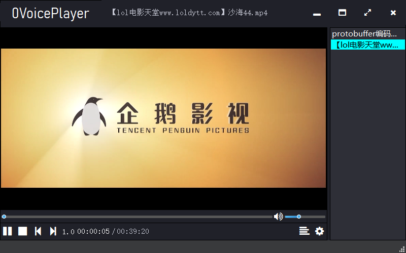

# 0voice_player 第 03 阶段

这一阶段可运行窗口和播放列表，源码展示 [`IjkPlayerQt`](src/ijkplayer_qt.cpp) 的消息循环和异步准备接口。界面与解码输出仍是分开的课堂内容。



## Windows 平台编译调试

按[Windows 快速开始](../../../README.md#windows)准备 FFmpeg 7.1.3，并按
[Windows 桌面依赖说明](../../../docs/ffmpeg-dependency.md#windows-desktop-dependencies)准备 x64 SDL2 和 Qt 6 Widgets。在仓库根目录构建这一阶段。

```powershell
cmake --preset voice-av-windows-all
cmake --build --preset voice-av-windows-all-debug --target voice_av_11_qt_player_03
```

目标生成在 `build/cmake/Debug/voice_av_11_qt_player_03.exe`。运行前将 x64 Qt 和 SDL2 的 DLL 目录加入当前终端的 `PATH`。
